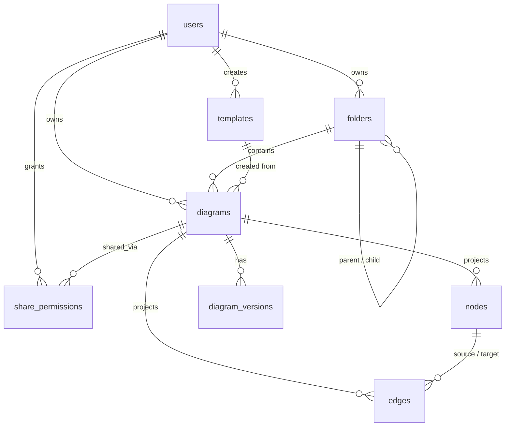

# Flowora — Database Design

| Field        | Value                                                             |
| ------------ | ----------------------------------------------------------------- |
| Version      | 1.0                                                               |
| Date         | 2026-11-14                                                        |
| Status       | Accepted                                                          |
| Source       | Flowora PRD v1.0 (14 Nov 2026), §11; [HLD](HLD.md); [LLD](LLD.md) |
| Related docs | [API Spec](API_SPEC.md) · [README](../README.md)                  |

## 1. Scope and MVP Status

This document defines the PostgreSQL schema for Flowora's **Phase 2** cloud layer (NestJS +
TypeORM in `apps/api`).

**MVP status — read this first:** the MVP web app is local-first and does not talk to any
database. Persistence is browser IndexedDB (`diagrams` + `drafts` stores — see
[LLD §4](LLD.md)). In the MVP, `apps/api` ships an **in-memory diagrams repository** (health
endpoint + diagrams CRUD module) with the TypeORM entities defined but **not wired to Postgres**.
Postgres wiring, migrations, and cloud sync are Phase 2. This schema is specified now so the
entities, the API, and the client document format are designed against the same target.

## 2. The Core Decision: JSONB Document as Source of Truth

### 2.1 Decision

`diagrams.content` is a **versioned JSONB blob holding the entire Flowora JSON v1 document** and
is the **source of truth** for a diagram. The `nodes` and `edges` tables are **normalized
projections** of that document, reserved for Phase 2 search/analytics, and are **not used by the
MVP read/write path**.

### 2.2 Justification

| Reason                         | Detail                                                                                                                                                                                                                      |
| ------------------------------ | --------------------------------------------------------------------------------------------------------------------------------------------------------------------------------------------------------------------------- |
| Whole-document access pattern  | Diagrams are always read and written as a whole: open a diagram, edit, save the document. There is no MVP operation that reads or writes a single node in isolation. One JSONB read/write serves the entire access pattern. |
| Avoids N+1 joins               | A normalized read would need `diagram + N nodes + M edges` (or joins over two large tables) for every open/save. JSONB is a single-row fetch.                                                                               |
| Versioned, validated schema    | The document carries `schemaVersion` and is validated by the shared zod schemas in `@flowora/shared` on both client and server. The database does not need to enforce node/edge shape — the schema package does.            |
| Offline/online format identity | The local IndexedDB document and the server JSONB document are byte-for-byte the same format. Sync is a document copy, not a translation. No mapping layer, no drift.                                                       |
| Migration path                 | Schema evolution is handled by `migrate()` in `@flowora/shared`, not by DDL. A v2 document migrates in application code; the column stays JSONB.                                                                            |
| Queryability when needed       | Postgres JSONB supports GIN indexes and `->`/`@>` operators, so Phase 2 search (e.g. "diagrams containing a node labelled X") works without normalization.                                                                  |

### 2.3 What the normalized tables are for

`nodes` and `edges` exist so Phase 2 features that genuinely need relational queries — full-text
search across a user's diagrams, analytics ("most-used shape types"), and fine-grained diffing —
can be built without scanning JSONB. They are populated by a projection step on save (server-side,
Phase 2) and are **derived data**: if they ever disagree with `diagrams.content`, the JSONB blob
wins and the projections are rebuilt.

## 3. Entity-Relationship Diagram

## 4. Tables

Conventions: all tables use `uuid` primary keys (`gen_random_uuid()`), `created_at` /
`updated_at` timestamps (`timestamptz`, UTC), and soft delete is **not** used — deletes are hard
deletes (recovery is the client's drafts store + `diagram_versions` in Phase 2). TypeORM entities
exist for every table below in `apps/api/src/**/*.entity.ts`.

### 4.1 `users`

| Column          | Type           | Constraints                     | Notes                              |
| --------------- | -------------- | ------------------------------- | ---------------------------------- |
| `id`            | `uuid`         | PK, default `gen_random_uuid()` |                                    |
| `email`         | `varchar(255)` | NOT NULL, UNIQUE                | Lowercased on write.               |
| `password_hash` | `varchar(255)` | NOT NULL                        | bcrypt; never returned by the API. |
| `display_name`  | `varchar(100)` | NULL                            |                                    |
| `created_at`    | `timestamptz`  | NOT NULL, default `now()`       |                                    |
| `updated_at`    | `timestamptz`  | NOT NULL, default `now()`       |                                    |

Indexes: `users_email_key` (unique, on `email`).

Phase 2 only — the MVP has no registration and no users table usage.

### 4.2 `folders`

| Column       | Type           | Constraints                                 | Notes                     |
| ------------ | -------------- | ------------------------------------------- | ------------------------- |
| `id`         | `uuid`         | PK, default `gen_random_uuid()`             |                           |
| `owner_id`   | `uuid`         | NOT NULL, FK → `users.id` ON DELETE CASCADE |                           |
| `parent_id`  | `uuid`         | NULL, FK → `folders.id` ON DELETE CASCADE   | NULL = root-level folder. |
| `name`       | `varchar(100)` | NOT NULL                                    |                           |
| `created_at` | `timestamptz`  | NOT NULL, default `now()`                   |                           |
| `updated_at` | `timestamptz`  | NOT NULL, default `now()`                   |                           |

Indexes: `idx_folders_owner_id` (`owner_id`); `idx_folders_parent_id` (`parent_id`).

### 4.3 `diagrams` — the core table

| Column           | Type           | Constraints                                  | Notes                                                                                                                              |
| ---------------- | -------------- | -------------------------------------------- | ---------------------------------------------------------------------------------------------------------------------------------- |
| `id`             | `uuid`         | PK, default `gen_random_uuid()`              | Same id as the client-side document `id`.                                                                                          |
| `owner_id`       | `uuid`         | NOT NULL, FK → `users.id` ON DELETE CASCADE  |                                                                                                                                    |
| `folder_id`      | `uuid`         | NULL, FK → `folders.id` ON DELETE SET NULL   | NULL = dashboard root.                                                                                                             |
| `template_id`    | `uuid`         | NULL, FK → `templates.id` ON DELETE SET NULL | Set when created from a template.                                                                                                  |
| `name`           | `varchar(200)` | NOT NULL                                     | Denormalized from `content.name` for list queries.                                                                                 |
| `type`           | `varchar(20)`  | NOT NULL                                     | `HLD`, `LLD`, `ERD`, `FLOWCHART`, `UML`, `SEQUENCE`, `NETWORK`, `CLOUD`, `DFD`, `BPMN`, `OTHER`. Denormalized from `content.type`. |
| `content`        | `jsonb`        | NOT NULL                                     | **Source of truth.** The full Flowora JSON v1 document. Validated by zod before write.                                             |
| `schema_version` | `smallint`     | NOT NULL, default `1`                        | Mirrors `content.schemaVersion`; lets queries filter by schema version without parsing JSONB.                                      |
| `version`        | `integer`      | NOT NULL, default `1`                        | Optimistic-locking counter; increments on every save. Mirrors `content.version`.                                                   |
| `created_at`     | `timestamptz`  | NOT NULL, default `now()`                    |                                                                                                                                    |
| `updated_at`     | `timestamptz`  | NOT NULL, default `now()`                    |                                                                                                                                    |

Indexes:

- `idx_diagrams_owner_id` (`owner_id`)
- `idx_diagrams_folder_id` (`folder_id`)
- `idx_diagrams_owner_updated` (`owner_id`, `updated_at` DESC) — dashboard list ordering
- `idx_diagrams_content_gin` (GIN on `content`) — Phase 2 JSONB search (`@>`, `->`)
- `idx_diagrams_type` (`type`) — filter by diagram type

**Write rule:** `name`, `type`, `schema_version`, and `version` are always derived from `content`
at write time; application code never sets them independently. The API validates `content` with
the shared zod schema before insert/update.

### 4.4 `nodes` — normalized projection (Phase 2, derived)

| Column       | Type               | Constraints                                    | Notes                                               |
| ------------ | ------------------ | ---------------------------------------------- | --------------------------------------------------- |
| `id`         | `uuid`             | PK, default `gen_random_uuid()`                | Row id, not the client node id.                     |
| `diagram_id` | `uuid`             | NOT NULL, FK → `diagrams.id` ON DELETE CASCADE |                                                     |
| `node_id`    | `varchar(64)`      | NOT NULL                                       | Client-side node id from the JSON document.         |
| `type`       | `varchar(64)`      | NOT NULL                                       | Node type (e.g. `service`, `database`, `decision`). |
| `label`      | `text`             | NULL                                           | Node label, for search.                             |
| `position_x` | `double precision` | NOT NULL                                       |                                                     |
| `position_y` | `double precision` | NOT NULL                                       |                                                     |
| `width`      | `double precision` | NULL                                           |                                                     |
| `height`     | `double precision` | NULL                                           |                                                     |
| `data`       | `jsonb`            | NULL                                           | Remaining node `data`/`style` payload.              |

Indexes: `idx_nodes_diagram_id` (`diagram_id`); `uq_nodes_diagram_node` (unique `diagram_id`, `node_id`);
`idx_nodes_label_trgm` (GIN trigram on `label`, Phase 2 search — requires `pg_trgm`).

**Not used by the MVP read/write path.** Rebuilt from `diagrams.content` on save in Phase 2.

### 4.5 `edges` — normalized projection (Phase 2, derived)

| Column           | Type          | Constraints                                    | Notes                                                           |
| ---------------- | ------------- | ---------------------------------------------- | --------------------------------------------------------------- |
| `id`             | `uuid`        | PK, default `gen_random_uuid()`                | Row id, not the client edge id.                                 |
| `diagram_id`     | `uuid`        | NOT NULL, FK → `diagrams.id` ON DELETE CASCADE |                                                                 |
| `edge_id`        | `varchar(64)` | NOT NULL                                       | Client-side edge id from the JSON document.                     |
| `source_node_id` | `varchar(64)` | NOT NULL                                       | Client-side source node id (not an FK — nodes are projections). |
| `target_node_id` | `varchar(64)` | NOT NULL                                       | Client-side target node id.                                     |
| `type`           | `varchar(32)` | NOT NULL                                       | `straight`, `smoothstep`, `bezier`.                             |
| `label`          | `text`        | NULL                                           | Edge label, for search.                                         |

Indexes: `idx_edges_diagram_id` (`diagram_id`); `uq_edges_diagram_edge` (unique `diagram_id`, `edge_id`).

**Not used by the MVP read/write path.** Rebuilt from `diagrams.content` on save in Phase 2.

### 4.6 `templates`

| Column        | Type           | Constraints                              | Notes                                                                        |
| ------------- | -------------- | ---------------------------------------- | ---------------------------------------------------------------------------- |
| `id`          | `uuid`         | PK, default `gen_random_uuid()`          |                                                                              |
| `name`        | `varchar(200)` | NOT NULL                                 | e.g. "HLD Payment Architecture".                                             |
| `type`        | `varchar(20)`  | NOT NULL                                 | Diagram type the template produces (same enum as `diagrams.type`).           |
| `description` | `text`         | NULL                                     |                                                                              |
| `content`     | `jsonb`        | NOT NULL                                 | A Flowora JSON v1 document (nodes/edges pre-filled; `id` reassigned on use). |
| `is_builtin`  | `boolean`      | NOT NULL, default `false`                | `true` for the seeded templates.                                             |
| `created_by`  | `uuid`         | NULL, FK → `users.id` ON DELETE SET NULL | NULL for built-in templates.                                                 |
| `created_at`  | `timestamptz`  | NOT NULL, default `now()`                |                                                                              |
| `updated_at`  | `timestamptz`  | NOT NULL, default `now()`                |                                                                              |

Indexes: `idx_templates_type` (`type`); `idx_templates_builtin` (`is_builtin`).

MVP note: the four seeded templates live in the client (`apps/web/src/templates/`). The
`templates` table is the Phase 2 home for server-side templates; built-ins are seeded from the
same content.

### 4.7 `diagram_versions`

| Column       | Type          | Constraints                                    | Notes                                        |
| ------------ | ------------- | ---------------------------------------------- | -------------------------------------------- |
| `id`         | `uuid`        | PK, default `gen_random_uuid()`                |                                              |
| `diagram_id` | `uuid`        | NOT NULL, FK → `diagrams.id` ON DELETE CASCADE |                                              |
| `version`    | `integer`     | NOT NULL                                       | Matches `diagrams.version` at snapshot time. |
| `content`    | `jsonb`       | NOT NULL                                       | Full document snapshot.                      |
| `created_by` | `uuid`        | NULL, FK → `users.id` ON DELETE SET NULL       |                                              |
| `created_at` | `timestamptz` | NOT NULL, default `now()`                      |                                              |

Indexes: `idx_versions_diagram_id` (`diagram_id`); `uq_versions_diagram_version` (unique `diagram_id`, `version`).

Phase 2: a version row is written on each save (retention policy TBD — e.g. last 50 versions).
Restore sets `diagrams.content` to the snapshot and bumps `version`.

### 4.8 `share_permissions`

| Column       | Type          | Constraints                                    | Notes                 |
| ------------ | ------------- | ---------------------------------------------- | --------------------- |
| `id`         | `uuid`        | PK, default `gen_random_uuid()`                |                       |
| `diagram_id` | `uuid`        | NOT NULL, FK → `diagrams.id` ON DELETE CASCADE |                       |
| `granted_to` | `uuid`        | NOT NULL, FK → `users.id` ON DELETE CASCADE    |                       |
| `granted_by` | `uuid`        | NOT NULL, FK → `users.id` ON DELETE CASCADE    |                       |
| `permission` | `varchar(10)` | NOT NULL                                       | `viewer` or `editor`. |
| `created_at` | `timestamptz` | NOT NULL, default `now()`                      |                       |

Indexes: `idx_share_diagram_id` (`diagram_id`); `idx_share_granted_to` (`granted_to`);
`uq_share_diagram_user` (unique `diagram_id`, `granted_to`) — one permission row per user per diagram.

Phase 2/3: owners always have full access; a `viewer` may read, an `editor` may read and write.
Enforced server-side on every diagram endpoint.

## 5. Index Summary

| Index                         | Table               | Columns / type                      | Purpose                              |
| ----------------------------- | ------------------- | ----------------------------------- | ------------------------------------ |
| `users_email_key`             | `users`             | `email` (unique)                    | Login lookup.                        |
| `idx_folders_owner_id`        | `folders`           | `owner_id`                          | List a user's folders.               |
| `idx_folders_parent_id`       | `folders`           | `parent_id`                         | Folder tree traversal.               |
| `idx_diagrams_owner_id`       | `diagrams`          | `owner_id`                          | List a user's diagrams.              |
| `idx_diagrams_folder_id`      | `diagrams`          | `folder_id`                         | List a folder's diagrams.            |
| `idx_diagrams_owner_updated`  | `diagrams`          | `owner_id`, `updated_at` DESC       | Dashboard ordering.                  |
| `idx_diagrams_content_gin`    | `diagrams`          | GIN (`content`)                     | Phase 2 JSONB search.                |
| `idx_diagrams_type`           | `diagrams`          | `type`                              | Filter by diagram type.              |
| `idx_nodes_diagram_id`        | `nodes`             | `diagram_id`                        | Projection rebuild / lookup.         |
| `uq_nodes_diagram_node`       | `nodes`             | `diagram_id`, `node_id` (unique)    | One projection row per node.         |
| `idx_nodes_label_trgm`        | `nodes`             | GIN trigram (`label`)               | Phase 2 label search.                |
| `idx_edges_diagram_id`        | `edges`             | `diagram_id`                        | Projection rebuild / lookup.         |
| `uq_edges_diagram_edge`       | `edges`             | `diagram_id`, `edge_id` (unique)    | One projection row per edge.         |
| `idx_templates_type`          | `templates`         | `type`                              | Template gallery filter.             |
| `idx_templates_builtin`       | `templates`         | `is_builtin`                        | Built-in template listing.           |
| `idx_versions_diagram_id`     | `diagram_versions`  | `diagram_id`                        | Version history listing.             |
| `uq_versions_diagram_version` | `diagram_versions`  | `diagram_id`, `version` (unique)    | One snapshot per version.            |
| `idx_share_diagram_id`        | `share_permissions` | `diagram_id`                        | Who a diagram is shared with.        |
| `idx_share_granted_to`        | `share_permissions` | `granted_to`                        | Diagrams shared with me.             |
| `uq_share_diagram_user`       | `share_permissions` | `diagram_id`, `granted_to` (unique) | One permission per user per diagram. |

## 6. Migrations Strategy

- **Tool:** TypeORM migrations (`apps/api/src/migrations/`), run via the TypeORM CLI.
  `synchronize` is **never** enabled outside local development.
- **Versioning:** one migration per schema change, timestamp-prefixed
  (`<timestamp>-<description>.ts`, e.g. `20261114000000-create-diagrams.ts`). Migrations are
  append-only and never edited after being applied anywhere.
- **Initial migration (Phase 2):** creates all eight tables, foreign keys, and indexes in §4–§5,
  plus the `pg_trgm` extension for label search.
- **Seeding:** built-in templates are seeded by a dedicated seed migration/script from the same
  content as `apps/web/src/templates/` so client and server templates match.
- **Document schema vs. DB schema:** Flowora JSON schema versions (`schemaVersion` in the
  document) evolve via `migrate()` in `@flowora/shared` — **not** via SQL migrations. A document
  version bump never requires DDL because `content` is JSONB.
- **Rollback:** every migration implements `down()`; production rollbacks restore from the
  pre-migration backup for destructive changes.

## 7. Data Volume and Growth (estimates)

| Entity                  | MVP                             | Phase 2 (year 1 estimate)                                 |
| ----------------------- | ------------------------------- | --------------------------------------------------------- |
| Diagrams per user       | Local only, unbounded by server | Tens to low hundreds; JSONB documents typically 5–200 KB. |
| Nodes/edges per diagram | Up to 1000+ elements (NFR-005)  | Same; projections grow linearly with diagram size.        |
| Versions per diagram    | N/A (client drafts only)        | Capped by retention policy (e.g. last 50).                |

JSONB storage dominates; row counts stay modest. No partitioning is planned for Phase 2.

## 8. Relationship to the Client (IndexedDB)

| Server (Phase 2)                            | Client (MVP, IndexedDB)                     | Notes                                                                                              |
| ------------------------------------------- | ------------------------------------------- | -------------------------------------------------------------------------------------------------- |
| `diagrams.content`                          | `diagrams` store value                      | Identical Flowora JSON v1 document.                                                                |
| `diagrams.id` / `name` / `type` / `version` | Document `id` / `name` / `type` / `version` | Same values; server denormalizes for querying.                                                     |
| `diagram_versions`                          | `drafts` store                              | Different mechanisms, same goal: recovery. Drafts are crash snapshots; versions are saved history. |
| `nodes` / `edges`                           | (none — document-embedded)                  | Client reads nodes/edges from the document, never from tables.                                     |
