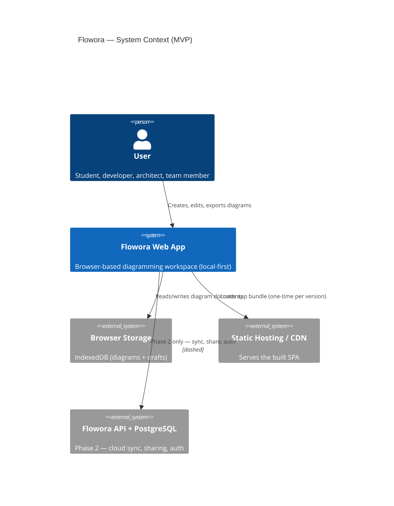
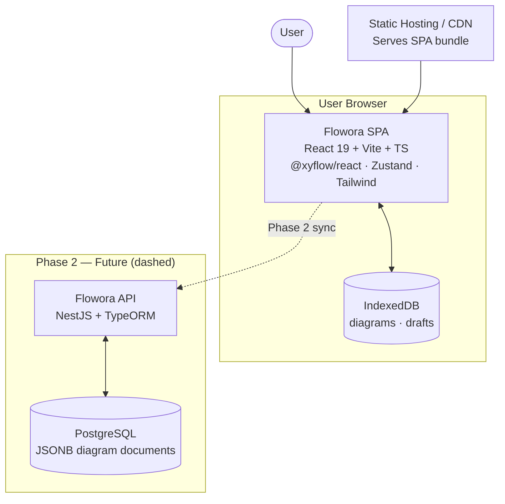
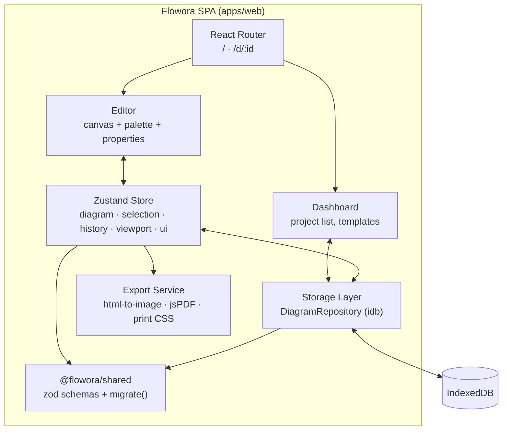
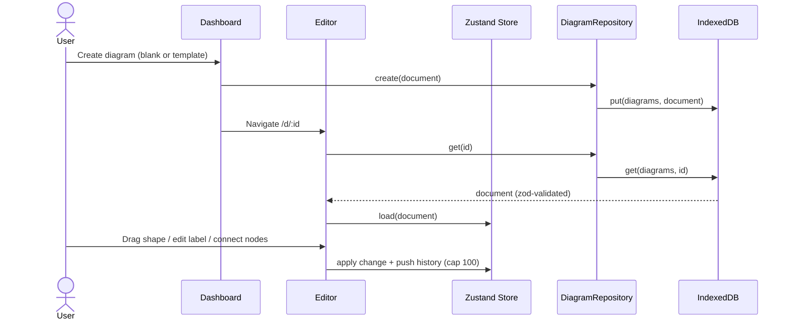
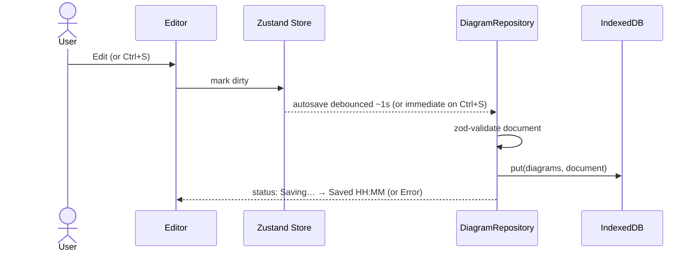
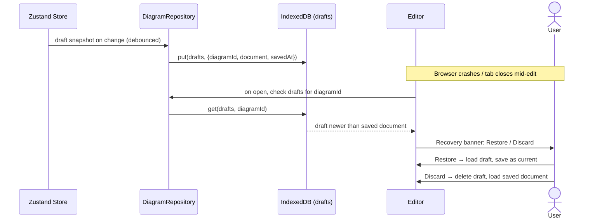
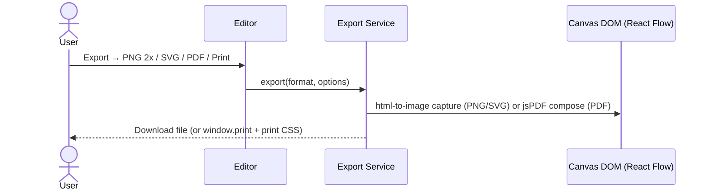

# Flowora — High-Level Design (HLD)

| Field        | Value                                                                                             |
| ------------ | ------------------------------------------------------------------------------------------------- |
| Version      | 1.0                                                                                               |
| Date         | 2026-11-14                                                                                        |
| Status       | Accepted                                                                                          |
| Source       | Flowora PRD v1.0 (14 Nov 2026), §18                                                               |
| Related docs | [LLD](LLD.md) · [Database Design](DATABASE.md) · [API Spec](API_SPEC.md) · [README](../README.md) |

## 1. Purpose

This document describes the system architecture of Flowora — _"Think. Draw. Connect."_ — a free,
browser-based diagramming workspace for students, developers, architects, and teams. Users create
HLD, LLD, ERD, flowcharts, UML, sequence, network, cloud, DFD, and BPMN diagrams via drag-and-drop.

Core value proposition: **"Create any diagram. Edit everything. Export anywhere."**

The MVP is **local-first**: the web app runs fully offline after load, with no mandatory
registration and no backend calls. Cloud sync (API + PostgreSQL) is a Phase 2 concern and is shown
as a future/optional element throughout this document.

## 2. System Context (C4 — Level 1)



**Actors**

| Actor                        | Description                                                                                         |
| ---------------------------- | --------------------------------------------------------------------------------------------------- |
| User                         | Creates and edits diagrams in the browser; exports PNG/SVG/PDF; prints. No account required in MVP. |
| (Phase 2) Authenticated user | Same as above, plus cloud sync, sharing, and version history via the API.                           |

**External systems**

| System                   | Role in MVP                                                                                                                         |
| ------------------------ | ----------------------------------------------------------------------------------------------------------------------------------- |
| Static hosting / CDN     | Serves the built Vite SPA (`apps/web`). No server-side rendering, no runtime backend dependency.                                    |
| Browser IndexedDB        | The MVP's only persistence layer. Two object stores: `diagrams` and `drafts`.                                                       |
| Flowora API + PostgreSQL | **Phase 2 only.** NestJS + TypeORM. MVP ships the API skeleton (health + in-memory diagrams CRUD) but the web app does not call it. |

## 3. Containers (C4 — Level 2)



### 3.1 Container responsibilities

| Container             | Technology                                                                                                         | Responsibility                                                                                                                                                  |
| --------------------- | ------------------------------------------------------------------------------------------------------------------ | --------------------------------------------------------------------------------------------------------------------------------------------------------------- |
| Flowora SPA           | Vite + React 19 + TypeScript (strict) + Tailwind CSS + @xyflow/react + Zustand + idb + zod + html-to-image + jspdf | All MVP behaviour: dashboard, canvas editing, properties, undo/redo, autosave, recovery, client-side export/print. Fully offline after first load.              |
| IndexedDB             | `idb` wrapper                                                                                                      | Local-first persistence. `diagrams` store holds saved `FloworaDocument` JSON; `drafts` store holds crash-recovery snapshots.                                    |
| Static hosting / CDN  | Any static host                                                                                                    | Serves the SPA. No dynamic server logic in MVP.                                                                                                                 |
| Flowora API (Phase 2) | NestJS + TypeORM                                                                                                   | Health, diagrams/folders/templates/share/versions endpoints. MVP: health + in-memory diagrams CRUD module only.                                                 |
| PostgreSQL (Phase 2)  | PostgreSQL 16+                                                                                                     | `Diagram.content` as versioned JSONB blob (source of truth); normalized Node/Edge tables reserved for Phase 2 search/analytics. See [DATABASE.md](DATABASE.md). |

### 3.2 Monorepo layout

```
flowora/
├── apps/
│   ├── web/        # Vite + React 19 SPA (the MVP product)
│   └── api/        # NestJS + TypeORM (Phase 2; MVP = health + in-memory CRUD)
├── packages/
│   └── shared/     # Flowora JSON v1 schema (zod + types), migration stub
├── docs/           # HLD, LLD, DATABASE, API_SPEC, openapi.yaml, adr/
└── .github/workflows/ci.yml
```

npm workspaces; root scripts `dev`, `build`, `typecheck`, `lint`, `test`; ESLint + Prettier at root;
Vitest for tests; GitHub Actions CI. See [ADR 0003](adr/0003-monorepo-npm-workspaces.md).

## 4. Components (C4 — Level 3, web app)



| Component         | Responsibility                                                                                                                                        |
| ----------------- | ----------------------------------------------------------------------------------------------------------------------------------------------------- |
| React Router      | Shareable URLs per diagram (`/d/:id`); dashboard at `/`.                                                                                              |
| Dashboard         | Lists diagrams, create/rename/delete/duplicate, template gallery, import `.flowora.json`.                                                             |
| Editor            | Canvas (React Flow), palette, properties panel, toolbar, status bar, export dialog, recovery banner, shortcuts popover.                               |
| Zustand store     | Single source of truth for editor state; five slices: `diagram`, `selection`, `history`, `viewport`, `ui`. History capped at 100 entries.             |
| Storage layer     | `DiagramRepository` interface; IndexedDB implementation via `idb`. Autosave (debounced ~1s) + crash recovery via the `drafts` store.                  |
| Export service    | PNG (1x/2x, transparent toggle) via html-to-image; SVG; PDF via jsPDF (A4/A3, portrait/landscape, fit-to-page); print via `window.print` + print CSS. |
| `@flowora/shared` | Flowora JSON v1 zod schemas + TypeScript types; `schemaVersion` + `migrate()` stub ready for v2.                                                      |

Component-level detail, store shapes, and sequence diagrams: [LLD.md](LLD.md).

## 5. Data Model (summary)

The canonical document is **Flowora JSON v1** (PRD §11, extended for production):

```json
{
  "id": "diagram-uuid",
  "name": "Payment Architecture",
  "type": "HLD",
  "schemaVersion": 1,
  "version": 1,
  "viewport": { "zoom": 1, "x": 0, "y": 0 },
  "nodes": [
    {
      "id": "n1",
      "type": "service",
      "position": { "x": 120, "y": 80 },
      "data": { "label": "API Gateway" },
      "width": 180,
      "height": 64,
      "style": {}
    }
  ],
  "edges": [
    {
      "id": "e1",
      "source": "n1",
      "target": "n2",
      "type": "smoothstep",
      "label": "HTTPS",
      "markerEnd": "arrow"
    }
  ],
  "metadata": { "createdAt": "2026-11-14T00:00:00Z", "updatedAt": "2026-11-14T00:00:00Z" }
}
```

Production schema also supports dimensions, styling, connector anchors, groups, and custom shapes.
Every document is validated by zod on load, import, and save. Schema migrations run through
`migrate()` in `@flowora/shared` (v1 only today; stub ready for v2).

**Storage decision (applies everywhere):** `Diagram.content` is a versioned JSONB blob holding the
whole Flowora JSON v1 document and is the source of truth. Node/Edge tables are normalized
projections reserved for Phase 2 search/analytics and are **not** used by the MVP read/write path.
Justification: diagrams are read/written as whole documents; the schema is versioned and
zod-validated; this avoids N+1 node/edge joins; and it keeps offline and online formats identical.
Full rationale: [DATABASE.md §2](DATABASE.md).

## 6. Data Flows

### 6.1 Create / edit a diagram



### 6.2 Save and autosave



Autosave is debounced (~1s of inactivity). Manual save is `Ctrl/Cmd+S`. Status is shown in the
status bar: `Saving…` / `Saved HH:MM` / `Error`. A failed save surfaces an error state; it never
silently discards edits.

### 6.3 Crash recovery



Recovery is **never a silent overwrite**: the banner requires an explicit Restore or Discard choice.
On a clean save the corresponding draft is cleared.

### 6.4 Export / print



All export is client-side. No diagram data leaves the browser in MVP.

### 6.5 Import / export of editable files

`.flowora.json` files are the portable format: export writes the validated Flowora JSON v1 document;
import reads it, zod-validates it, runs `migrate()` if `schemaVersion` differs, and rejects invalid
files with a clear error. Import never overwrites an existing diagram without creating a new one.

## 7. Scalability

| Concern               | MVP approach                                                                                                  | Phase 2+                                                                                                             |
| --------------------- | ------------------------------------------------------------------------------------------------------------- | -------------------------------------------------------------------------------------------------------------------- |
| Users                 | No server state per user; static hosting scales trivially via CDN.                                            | API is stateless NestJS; horizontal scaling behind a load balancer; Postgres read replicas if needed.                |
| Diagram size          | Target 1000+ elements per diagram; React Flow virtualization + debounced persistence keep interaction <100ms. | Same client; server stores whole JSONB documents, so document size is the only scaling variable.                     |
| Storage               | Browser IndexedDB quota (typically hundreds of MB to GB); documents are small JSON.                           | Postgres JSONB with GIN indexes on `content` for Phase 2 search; object storage for exported assets if needed.       |
| Collaboration (P2/P3) | Out of scope for MVP.                                                                                         | Operational transform / CRDT evaluation deferred; API `versions` and `share_permissions` tables are designed for it. |

## 8. Reliability

- **No single point of failure in MVP:** the app is a static bundle; persistence is local. If the CDN
  is reachable once, the editor works offline indefinitely.
- **Data durability:** every edit is autosaved (~1s debounce) to IndexedDB and snapshotted to the
  `drafts` store; crash recovery restores from the draft with explicit user consent.
- **Validation:** zod schemas guard every load/import/save boundary, so corrupt or foreign JSON can
  never poison the store.
- **Error handling:** save/export failures surface visible status (status bar / dialog) with a retry
  path; no silent failures. See [LLD §7](LLD.md).
- **Availability target:** 99.9% for the hosted static app (PRD NFR); the editor itself is
  unaffected by backend outages because there is no backend dependency in MVP.

## 9. Security

| Control          | MVP                                                                                  | Phase 2                                                                   |
| ---------------- | ------------------------------------------------------------------------------------ | ------------------------------------------------------------------------- |
| Authentication   | None required (local-first, no accounts).                                            | JWT (access + refresh), bcrypt password hashing.                          |
| Authorization    | N/A (local data only).                                                               | Owner + `share_permissions` (viewer/editor) enforced server-side.         |
| Data in transit  | HTTPS via static host.                                                               | HTTPS; JWT in Authorization header.                                       |
| Data at rest     | Browser storage, same-origin.                                                        | Postgres at rest; secrets via environment variables, never in code.       |
| Input validation | zod on all document boundaries (load, import, save).                                 | Same zod schemas shared via `@flowora/shared`, plus class-validator DTOs. |
| XSS              | React escaping; no `dangerouslySetInnerHTML` for user content; SVG export sanitized. | Same, plus server-side content validation.                                |
| Secrets          | None in the client bundle.                                                           | Env-based; CI secret scanning.                                            |

## 10. NFR Mapping (PRD §10)

| PRD NFR                           | Target                                              | How Flowora meets it                                                                                                  |
| --------------------------------- | --------------------------------------------------- | --------------------------------------------------------------------------------------------------------------------- |
| NFR-001 Performance — editor load | < 3s                                                | Vite code-split SPA on CDN; lazy-loaded templates; no backend round-trip before first paint.                          |
| NFR-002 Performance — interaction | < 100ms                                             | React Flow rendering + Zustand local state; no network in the edit loop; debounced persistence off the critical path. |
| NFR-003 Performance — save        | < 1s                                                | IndexedDB local write of a single JSON document; no network.                                                          |
| NFR-004 Performance — export      | < 5s                                                | Client-side html-to-image/jsPDF; no upload/download round-trip.                                                       |
| NFR-005 Capacity                  | 1000+ elements per diagram                          | React Flow handles large graphs; whole-document JSON stays small; history capped at 100 to bound memory.              |
| Security                          | Local-first privacy; no mandatory accounts          | No data leaves the browser in MVP; zod validation at every boundary; Phase 2 adds JWT + share permissions.            |
| Reliability                       | No data loss on crash/refresh                       | Autosave ~1s + drafts store + explicit Restore/Discard recovery banner.                                               |
| Availability                      | 99.9% hosted availability target                    | Static hosting + CDN; editor works offline after first load, so backend downtime cannot block editing.                |
| Compatibility                     | Chrome/Edge/Firefox/Safari (current), desktop-first | Standard web APIs (IndexedDB, Canvas, SVG); no browser-specific plugins; responsive layout with desktop-first canvas. |
| Scalability                       | Grow from MVP to cloud sync                         | Stateless API design, JSONB documents, shared schema package; see §7.                                                 |
| Accessibility                     | Keyboard-operable editing                           | Full keyboard shortcut map (see LLD §8); focus-visible controls; labelled palette and properties.                     |
| Portability                       | Diagrams move freely                                | `.flowora.json` import/export (zod-validated); PNG/SVG/PDF export; no vendor lock-in.                                 |

## 11. Deployment (MVP)

1. `npm run build` produces the static SPA in `apps/web/dist`.
2. Deploy `dist/` to any static host / CDN (no server process required).
3. `apps/api` is **not** deployed for MVP; its Phase 2 deployment is a standard NestJS service
   (Node 20+) in front of PostgreSQL, with migrations run via TypeORM CLI.
4. CI (GitHub Actions, `.github/workflows/ci.yml`) runs `typecheck`, `lint`, `test`, and `build`
   on every PR.

## 12. Open Decisions / Future Work

- Phase 2: cloud sync conflict resolution (last-write-wins vs. merge) — to be decided before the
  sync module is built; the `version` field and `diagram_versions` table are designed to support it.
- Phase 2/3: real-time collaboration engine (CRDT vs. OT) — deferred; not in MVP scope.
- Phase 2: server-side export job (for large diagrams / headless rendering) — API surface is
  specified in [API_SPEC.md](API_SPEC.md) but not implemented in MVP.
