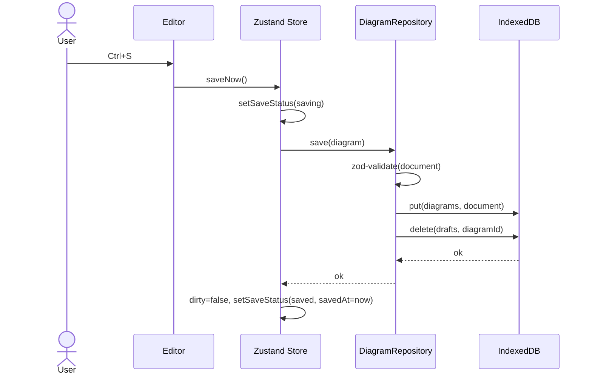
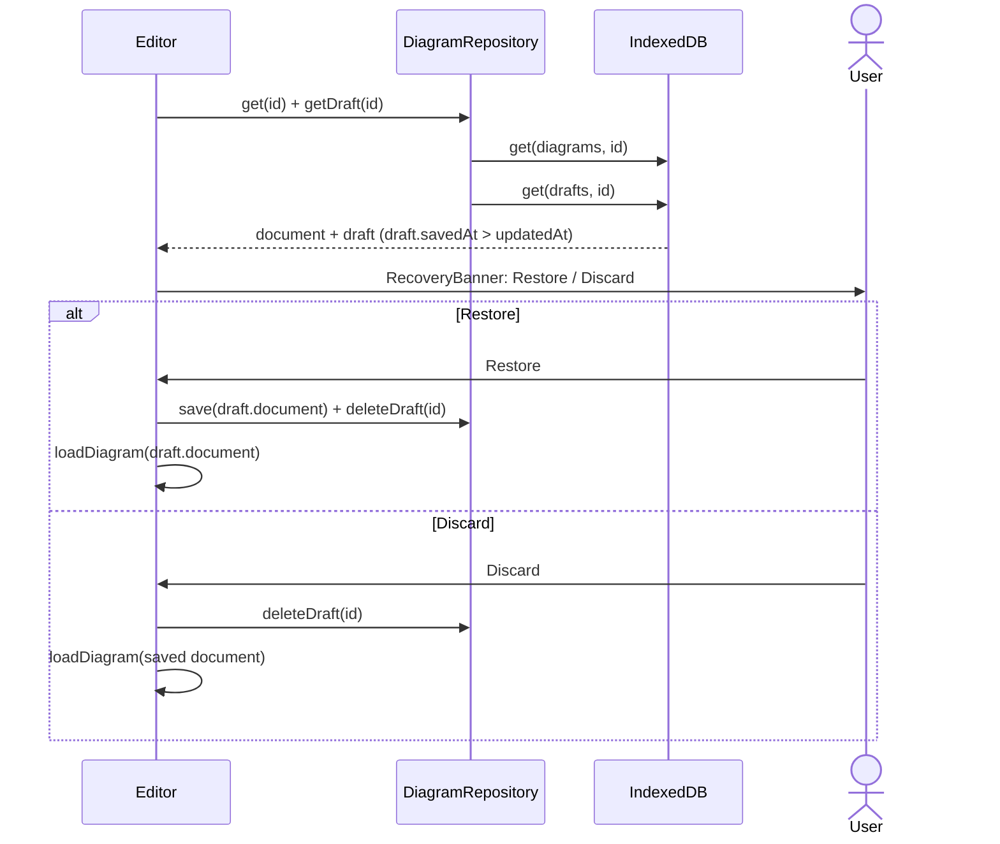
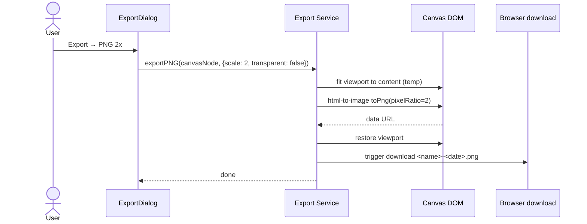

# Flowora — Low-Level Design (LLD)

| Field        | Value                                                                             |
| ------------ | --------------------------------------------------------------------------------- |
| Version      | 1.0                                                                               |
| Date         | 2026-11-14                                                                        |
| Status       | Accepted                                                                          |
| Source       | Flowora PRD v1.0 (14 Nov 2026); [HLD](HLD.md)                                     |
| Related docs | [Database Design](DATABASE.md) · [API Spec](API_SPEC.md) · [README](../README.md) |

## 1. Scope

Module- and class-level design of the Flowora MVP. The web app (`apps/web`) is the whole MVP
product surface; `apps/api` is a skeleton (health + in-memory diagrams CRUD) and
`packages/shared` holds the Flowora JSON v1 schema. Covered here: component tree, Zustand store,
storage layer, export service, sequence diagrams, error handling, keyboard shortcuts.

## 2. Web Component Tree (`apps/web/src`)

```
src/
├── main.tsx                  # React root, RouterProvider, store init
├── App.tsx                   # Route shell: / → Dashboard, /d/:id → Editor
├── routes/
│   ├── Dashboard.tsx         # Project list, create/rename/delete/duplicate, import
│   └── Editor.tsx            # Toolbar + palette + canvas + properties + status bar
├── components/
│   ├── Palette.tsx           # Shape palette: Basic / Flowchart / ERD / HLD-Cloud / UML
│   ├── Canvas.tsx            # React Flow wrapper: nodes, edges, selection, pan/zoom
│   ├── nodes/CustomNode.tsx  # Double-click inline label edit, resize handles
│   ├── edges/CustomEdge.tsx  # Straight / smoothstep / bezier, arrows, labels
│   ├── PropertiesPanel.tsx   # Node / edge / canvas properties (see §3.3)
│   ├── Toolbar.tsx           # Undo/redo, clipboard, align, zoom, fit, save, export, (?)
│   ├── StatusBar.tsx         # Save status, element count, zoom %
│   ├── ExportDialog.tsx      # PNG 1x/2x + transparent, SVG, PDF options, print
│   ├── RecoveryBanner.tsx    # Crash-recovery prompt: Restore / Discard
│   ├── ShortcutsPopover.tsx  # Keyboard shortcut reference (opened with ?)
│   └── TemplateGallery.tsx   # Seeded templates on the dashboard
├── templates/                # hld-payment, lld-order-service, erd-student-course,
│                             # flowchart-login (see §2.1 / README)
├── store/editorStore.ts      # Zustand store (see §3)
├── storage/
│   ├── repository.ts         # DiagramRepository interface
│   ├── indexedDbRepository.ts# idb implementation (diagrams + drafts stores)
│   └── autosave.ts           # Debounced autosave + draft snapshots
├── services/exportService.ts # PNG / SVG / PDF / print (see §5)
├── hooks/
│   ├── useKeyboardShortcuts.ts
│   └── useAutosave.ts
└── lib/validation.ts         # zod re-exports from @flowora/shared
```

### 2.1 Component responsibilities

| Component          | Responsibility                                                                                                                                                                                                                                      |
| ------------------ | --------------------------------------------------------------------------------------------------------------------------------------------------------------------------------------------------------------------------------------------------- |
| `App`              | Router shell; global error boundary.                                                                                                                                                                                                                |
| `Dashboard`        | Lists diagrams (name, type, updatedAt); create blank / from template; rename, delete, duplicate; import `.flowora.json`. Reads `DiagramRepository.list()`; no editor store.                                                                         |
| `Editor`           | Owns `/d/:id`; loads the document, mounts Canvas + Palette + PropertiesPanel + Toolbar + StatusBar; renders RecoveryBanner when a draft exists.                                                                                                     |
| `Palette`          | Draggable shape library in five categories: Basic, Flowchart, ERD, HLD-Cloud, UML. Drag start sets the node type; drop on canvas creates the node.                                                                                                  |
| `Canvas`           | React Flow (`@xyflow/react`): `nodes`, `edges`, `onNodesChange`, `onEdgesChange`, `onConnect`; multi-select (shift / drag box); pan + zoom; fit-to-screen; snap-to-grid toggle; background + grid. Controlled by the `diagram` + `viewport` slices. |
| `CustomNode`       | Node with label, fill, border; double-click switches the label to inline edit (commit on Enter/blur, cancel on Escape); resize via React Flow node resizing.                                                                                        |
| `CustomEdge`       | Straight / smoothstep / bezier paths with optional arrow markers and a centered label; label editable via the properties panel.                                                                                                                     |
| `PropertiesPanel`  | Context-sensitive: node (label, font size, fill, border color/width, text align, width/height), edge (label, type, color, arrowhead, animated), canvas (background, grid on/off, snap on/off). Empty selection shows canvas properties.             |
| `Toolbar`          | Undo/redo, copy/paste/duplicate, delete, align left/center/right, zoom in/out, fit view, save, export, shortcuts (`?`). Buttons disabled when inapplicable (e.g. redo with empty redo stack).                                                       |
| `StatusBar`        | Save status, element count, zoom percentage, diagram type.                                                                                                                                                                                          |
| `ExportDialog`     | Format picker (PNG / SVG / PDF / Print): PNG scale 1x/2x + transparent toggle; PDF page size A4/A3 + orientation + fit-to-page. Calls `exportService`; shows progress + error.                                                                      |
| `RecoveryBanner`   | Shown when a draft newer than the saved document exists. Buttons: Restore (load draft, save) / Discard (delete draft, load saved). Dismissing is not an option — the user must choose.                                                              |
| `ShortcutsPopover` | Read-only shortcut table; opened with `?` or the toolbar button; closed with `?` / Escape / click-outside.                                                                                                                                          |

## 3. Zustand Store (`store/editorStore.ts`)

One store, five slices, created with `create<EditorState>()(...)` (vanilla Zustand; history logic
implemented in the slice itself, no middleware).

### 3.1 State shape

```ts
interface EditorState {
  // diagram slice — the loaded document (Flowora JSON v1)
  diagram: FloworaDocument | null;
  dirty: boolean;
  selectedNodeIds: string[];
  selectedEdgeIds: string[];
  past: FloworaDocument[]; // undo stack, cap 100; oldest dropped on overflow
  future: FloworaDocument[]; // redo stack; cleared on every new edit
  viewport: { zoom: number; x: number; y: number };
  ui: {
    saveStatus: 'idle' | 'saving' | 'saved' | 'error';
    savedAt: string | null; // ISO timestamp of last successful save
    saveError: string | null;
    pendingDraft: Draft | null; // recovery banner payload
    shortcutsOpen: boolean;
    exportDialogOpen: boolean;
    paletteCategory: 'Basic' | 'Flowchart' | 'ERD' | 'HLD-Cloud' | 'UML';
  };

  // actions: see §3.2
}
```

### 3.2 Actions

- `loadDiagram(doc)` — sets `diagram`, clears `past`/`future`, `dirty = false`, resets selection.
- `applyChange(mutator)` — pushes current `diagram` onto `past` (cap 100, drop oldest), clears `future`, applies the mutator immutably, sets `dirty = true`, triggers autosave (debounced) + draft snapshot. **All edits** (add/move/edit node, add/edit edge, style change, align, paste, delete) go through this single funnel.
- `undo()` / `redo()` — move snapshots between `past` and `future`, set `dirty = true` (so the undone state is autosaved). No-op when the source stack is empty. Viewport-only changes (pan/zoom) never create history entries.
- `setSelection(nodeIds, edgeIds)` — updates the selection slice; drives PropertiesPanel + toolbar enablement. `selectAll()` selects every node and edge id.
- `copySelection()` / `paste()` / `duplicateSelection()` — clipboard holds serialized nodes/edges (in-memory); paste offsets positions by (+24, +24) and assigns new ids; duplicate is copy + paste in one step.
- `deleteSelection()` — removes selected nodes and any edges attached to them, plus selected edges.
- `align(direction)` — aligns selected nodes left / center / right by their bounding box.
- `setViewport(vp)` — syncs React Flow viewport into the store (persisted in `document.viewport` on save).
- `setSaveStatus(status, error?)`, `setPendingDraft(draft | null)`, `setShortcutsOpen` / `setExportDialogOpen` / `setPaletteCategory` — UI state.

### 3.3 Properties panel field map

| Target                | Fields                                                                                                                                                       |
| --------------------- | ------------------------------------------------------------------------------------------------------------------------------------------------------------ |
| Node                  | label (text), font size (number), fill (color), border color (color), border width (number), text align (left/center/right), width (number), height (number) |
| Edge                  | label (text), type (straight / smoothstep / bezier), color (color), arrowhead (none / arrow / arrow-closed), animated (boolean)                              |
| Canvas (no selection) | background (color), grid on/off (boolean), snap-to-grid on/off (boolean)                                                                                     |

Every field change goes through `applyChange`, so styling is undoable and autosaved like any edit.

## 4. Storage Layer (`storage/`)

### 4.1 `DiagramRepository` interface

```ts
interface DiagramRepository {
  list(): Promise<DiagramMeta[]>; // id, name, type, updatedAt — no full content
  get(id: string): Promise<FloworaDocument | null>;
  create(doc: FloworaDocument): Promise<void>;
  save(doc: FloworaDocument): Promise<void>; // upsert; zod-validates first
  delete(id: string): Promise<void>;
  duplicate(id: string): Promise<FloworaDocument>; // new id, "Copy of <name>"
  getDraft(diagramId: string): Promise<Draft | null>;
  saveDraft(draft: Draft): Promise<void>;
  deleteDraft(diagramId: string): Promise<void>;
}

interface Draft {
  diagramId: string;
  document: FloworaDocument;
  savedAt: string; // ISO timestamp
}
```

The interface exists so a future cloud-backed repository (Phase 2) can implement the same
contract; the MVP ships only the IndexedDB implementation.

### 4.2 IndexedDB implementation (`indexedDbRepository.ts`, via `idb`)

Database `flowora`, version `1`. Object store `diagrams`: keyPath `id`, index `by-updatedAt` on
`metadata.updatedAt` (dashboard sort). Object store `drafts`: keyPath `diagramId`. All writes are
zod-validated before `put`; a validation failure rejects the promise and surfaces as a save error
— invalid data is never persisted. `list()` returns metadata only (no `nodes`/`edges`) to keep
the dashboard fast.

### 4.3 Autosave (`autosave.ts` + `useAutosave` hook)

- Trigger: any `applyChange` while `dirty === true`. Debounce: ~1s of inactivity, then `save()`;
  a new edit inside the window resets the timer.
- Status transitions: `idle → saving → saved` (with `savedAt`) or `saving → error` (with message;
  retry on next edit or manual `Ctrl+S`).
- Draft snapshot: written on the same debounce to the `drafts` store, so a crash between edits
  still recovers. Cleared on successful `save()`.
- Manual save (`Ctrl/Cmd+S`) bypasses the debounce and saves immediately; the browser's native
  save dialog is prevented (`event.preventDefault()`).

### 4.4 Recovery flow

1. On editor open, `getDraft(diagramId)` is checked after the saved document loads. If a draft
   exists and `draft.savedAt > document.metadata.updatedAt`, set `ui.pendingDraft` and render
   `RecoveryBanner`.
2. **Restore:** `loadDiagram(draft.document)`, then `save()` (which clears the draft).
   **Discard:** `deleteDraft(diagramId)`, keep the saved document loaded.
3. There is no third path: the banner stays until the user chooses. Recovery never silently
   overwrites the saved document.

## 5. Export Service (`services/exportService.ts`)

All export runs client-side; no diagram data leaves the browser.

| Function                                     | Input                                            | Output                   | Implementation                                                                                                                                       |
| -------------------------------------------- | ------------------------------------------------ | ------------------------ | ---------------------------------------------------------------------------------------------------------------------------------------------------- |
| `exportPNG(node, { scale, transparent })`    | Canvas DOM node, scale 1x/2x, transparent toggle | `.png` download          | `html-to-image` `toPng` with `pixelRatio` = scale; `backgroundColor` omitted when transparent.                                                       |
| `exportSVG(node)`                            | Canvas DOM node                                  | `.svg` download          | `html-to-image` `toSvg`.                                                                                                                             |
| `exportPDF(node, { pageSize, orientation })` | Canvas DOM node, A4/A3, portrait/landscape       | `.pdf` download          | Capture PNG via html-to-image, embed into jsPDF, scale to fit page (fit-to-page, aspect preserved).                                                  |
| `printDiagram()`                             | —                                                | Print dialog             | `window.print()` + print CSS that shows only the canvas (hides palette/panels/toolbar).                                                              |
| `exportFloworaJSON(doc)`                     | Document                                         | `.flowora.json` download | `JSON.stringify` of the zod-validated document.                                                                                                      |
| `importFloworaJSON(file)`                    | File                                             | `FloworaDocument`        | `JSON.parse` → zod validate → `migrate()` if `schemaVersion` differs → new diagram via `create()`. Invalid files are rejected with a readable error. |

**Export details:** before capture, the canvas is fitted to content (temporary viewport) so the
export contains the whole diagram, then the viewport is restored. Export runs with a busy state
in `ExportDialog`; failures (e.g. canvas too large for the browser image encoder) surface as an
error with a retry and suggest a smaller scale. Filenames: `<diagram-name>-<yyyy-mm-dd>.<ext>`,
sanitized (non-alphanumeric → `-`).

## 6. Sequence Diagrams

### 6.1 Save (manual, Ctrl+S)



### 6.2 Autosave (debounced)

```mermaid
sequenceDiagram
    actor U as User
    participant S as Zustand Store
    participant A as Autosave (debounce ~1s)
    participant R as DiagramRepository
    participant I as IndexedDB

    U->>S: applyChange(...) — edit
    S->>S: dirty=true, setSaveStatus(idle)
    S->>A: schedule()
    Note over A: 1s quiet window; new edits reset timer
    A->>R: save(diagram) + saveDraft(draft)
    R->>I: put(diagrams, document)
    R->>I: put(drafts, draft)
    I-->>R: ok
    R-->>S: ok
    S->>S: dirty=false, setSaveStatus(saved)
```

### 6.3 Recovery



### 6.4 Export (PNG)



## 7. Error Handling Strategy

| Failure                                               | Detection                             | User-visible behaviour                                                             | Recovery                                                                                                                  |
| ----------------------------------------------------- | ------------------------------------- | ---------------------------------------------------------------------------------- | ------------------------------------------------------------------------------------------------------------------------- |
| IndexedDB unavailable (private mode, quota, disabled) | `idb` open/`put` rejection            | Status bar shows `Error`; banner on dashboard explaining local save is unavailable | Editing continues in memory; user can export `.flowora.json` to preserve work; retry on next save attempt.                |
| Save validation failure (zod)                         | `save()` rejects before `put`         | Status bar `Error` with message                                                    | Document stays in memory; user can keep editing; report via console error with the zod issue list.                        |
| Corrupt document on load                              | zod validation on `get()`             | Editor shows an error state with the diagram name; offers "Open dashboard"         | Document is not auto-repaired or deleted; user can delete it from the dashboard or restore from a `.flowora.json` export. |
| Invalid import file                                   | zod validation in `importFloworaJSON` | Dialog error naming the problem (bad JSON / schema mismatch / unsupported version) | No diagram is created; user can pick another file.                                                                        |
| Export failure (canvas too large, encoder error)      | html-to-image/jsPDF rejection         | Export dialog error + retry; suggests 1x scale                                     | Viewport is always restored; no data loss.                                                                                |
| IndexedDB quota exceeded                              | `QuotaExceededError` on `put`         | Status bar `Error` + hint to export/delete old diagrams                            | Draft write is attempted separately so recovery may still work; user frees space via the dashboard.                       |

**Principles:** no silent failures (every failure surfaces in the status bar, a banner, or a
dialog); no destructive auto-recovery (corrupt data is never auto-deleted or auto-overwritten);
errors are logged to the console with context (operation, diagram id, error); the editor never
blocks on a failed save — editing continues in memory.

## 8. Keyboard Shortcut Map

All shortcuts are handled by `useKeyboardShortcuts` (global keydown listener on the editor
route) and ignored while focus is inside a text input/textarea (except Escape/Enter inside inline
label edit). `Ctrl` on Windows/Linux, `Cmd` on macOS. Shortcuts are discoverable via the `?`
popover and toolbar-button tooltips.

| Shortcut                      | Action                   | Notes                                                       |
| ----------------------------- | ------------------------ | ----------------------------------------------------------- |
| `Ctrl/Cmd+Z`                  | Undo                     | Disabled (no-op) when history is empty.                     |
| `Ctrl/Cmd+Shift+Z` / `Ctrl+Y` | Redo                     | Both bindings supported.                                    |
| `Ctrl/Cmd+C`                  | Copy selection           | Serializes selected nodes + their internal edges.           |
| `Ctrl/Cmd+V`                  | Paste                    | Offsets (+24, +24), new ids, selects pasted nodes.          |
| `Ctrl/Cmd+D`                  | Duplicate selection      | Copy + paste in one step; prevents browser bookmark dialog. |
| `Del` / `Backspace`           | Delete selection         | Deletes nodes + attached edges + selected edges.            |
| `Ctrl/Cmd+S`                  | Save now                 | Prevents browser save dialog; bypasses autosave debounce.   |
| `Ctrl/Cmd+A`                  | Select all               | Selects all nodes and edges.                                |
| `?`                           | Toggle shortcuts popover | `Shift+/` on most layouts.                                  |
| `F`                           | Fit view                 | Fits the whole diagram in the viewport.                     |
| `+` / `-`                     | Zoom in / out            | Also available via the zoom controls.                       |

Shortcuts are discoverable via the `?` popover and via tooltips on toolbar buttons.

## 9. Shared Package (`packages/shared`)

| Export                                                 | Purpose                                                                                                                              |
| ------------------------------------------------------ | ------------------------------------------------------------------------------------------------------------------------------------ |
| `FloworaDocumentSchema` (zod) + `FloworaDocument` type | Whole-document schema; `schemaVersion`, `version`, `viewport`, `nodes`, `edges`, `metadata`.                                         |
| `FloworaNodeSchema` / `FloworaNode`                    | Node: `id`, `type`, `position`, `data.label`, optional `width`/`height`, `style`, anchors.                                           |
| `FloworaEdgeSchema` / `FloworaEdge`                    | Edge: `id`, `source`, `target`, `type` (straight/smoothstep/bezier), `label`, `markerEnd`, `animated`.                               |
| `migrate(doc)`                                         | Upgrades older `schemaVersion` documents to the current version. v1 only today; the function and version switch are in place for v2. |
| `createEmptyDocument(name, type)`                      | Factory for new diagrams (fresh ids, `schemaVersion: 1`, `version: 1`).                                                              |

The web app imports the schemas for load/import/save validation; the API (Phase 2) reuses the
same package so client and server can never disagree about the document shape.

## 10. Testing Approach

- **Unit (Vitest):** store actions (undo/redo cap, copy/paste id regeneration, align math),
  zod schemas (valid/invalid documents, migration stub), repository (against `fake-indexeddb`),
  export filename sanitization.
- **Component (Vitest + Testing Library):** PropertiesPanel field rendering per selection type,
  RecoveryBanner Restore/Discard behaviour, ExportDialog option state.
- **Manual:** seeded templates open correctly; 1000-element stress diagram stays interactive;
  export each format at 1x/2x; crash-recovery banner appears after a forced tab kill.
  CI runs `typecheck`, `lint`, `test`, `build` on every PR.
